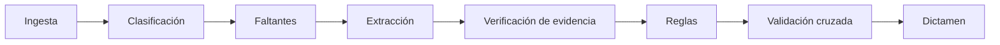
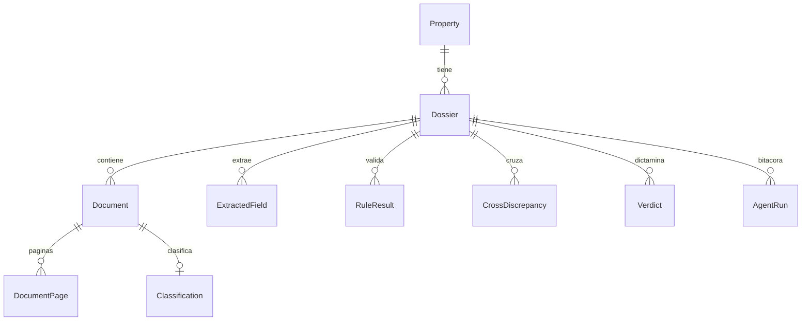

# Sistema Multiagente para Análisis Inteligente de Expedientes de Inmuebles

Aplicación Django que recibe PDF de un inmueble, los clasifica, extrae datos **con evidencia literal verificable**, los valida contra reglas
externas (YAML), cruza la información entre documentos y emite una **recomendación inicial** (`cumple` / `requiere_revision` / `no_cumple`).
No es una decisión legal definitiva.

## Instalación
```bash
python -m venv .venv && source .venv/bin/activate
pip install -r requirements.txt
cp .env.example .env && export $(grep -v '^#' .env | xargs)
docker compose up -d                       # PostgreSQL + Redis
python manage.py migrate
python manage.py createsuperuser           # luego asigne el rol en /admin (legal_analyst | legal_supervisor | tech_admin)
python manage.py runserver
celery -A config worker -l info            # en otra terminal
```
Sin Docker: `DATABASE_URL=sqlite:///db.sqlite3 CELERY_EAGER=1 python manage.py runserver` ejecuta el análisis en el mismo proceso.

## Pruebas y calidad
```bash
pytest            # 57 pruebas (núcleo, agentes, seguridad, API, exportación)
ruff check .
```

## Arquitectura
```
Presentación  apps/*/views.py, templates/, DRF (apps/dossiers/api.py)
Aplicación    apps/dossiers/services.py (Facade), apps/processing/{runner,tasks}.py
Dominio       core/  ← Python puro, SIN Django: contratos Pydantic, normalización, reglas, agentes, supervisor
Infraestructura apps/*/models.py, almacenamiento privado, Celery, core/ports.py (PyMuPDF, Tesseract, Ollama)
```
Dependencias: presentación → aplicación → dominio ← infraestructura. Los agentes solo conocen *puertos* (`LLMPort`, `OCRPort`).

### Flujo multiagente

`core/graph/supervisor.py` coordina y es el **único** que escribe el estado compartido (`DossierState`); cada agente devuelve una salida
Pydantic. Cada ejecución se registra en `AgentRun` (salida estructurada, estado, ms, reintentos, error) vía Observer.
`core/graph/langgraph_builder.py` expone el mismo flujo como grafo LangGraph (probado equivalente); el runner usa el Supervisor
porque permite reanudar desde una etapa (correcciones manuales) y reintentos por agente.

### Integración Django ↔ Celery ↔ agentes
Vista → `DossierAnalysisFacade` → `transaction.on_commit` → tarea Celery `analyze_dossier` → `runner.run_analysis`
(BD → `DossierState` → Supervisor → persistencia). Los agentes nunca importan Django.

### Patrones aplicados
Facade (`DossierAnalysisFacade`), Strategy (`core/rules.py: STRATEGIES`), Factory Method (`ExtractorFactory`), Template Method (`BaseExtractor.extract`),
Adapter (`core/ports.py`), Observer (`Supervisor` → `DBObserver`), Specification (`apps/dossiers/specs.py`), Supervisor.

### Modelo entidad-relación

Apps: `accounts` (roles), `dossiers` (Property, Dossier, Facade, Specification, API), `documents` (carga segura, páginas, clasificación, visor PDF),
`findings` (datos extraídos versionados), `validations` (reglas, discrepancias, versiones de configuración), `processing` (runner, Celery, bitácora),
`reports` (dictamen, exportación PDF/JSON), `audit`. *Decisión:* `properties` se fusionó en `dossiers` (una sola entidad pequeña) para evitar una app sin responsabilidad propia.

## Reglas de dictamen (conservadoras)
- **No cumple** solo si hay una regla **no provisional** fallida, con evidencia **verificada** y en un documento con clasificación confiable.
- Cualquier duda (faltantes, baja certeza, evidencia no verificada, reglas indeterminadas o provisionales, discrepancias, confianza < umbral) → **Requiere revisión**.
- Las discrepancias entre documentos nunca producen *No cumple* por sí solas.
- Confianza global = mínimo entre certeza de clasificación, proporción de datos verificados y cobertura de reglas determinadas.

## Criterios PENDIENTES de confirmación oficial (no inventados)
Todo está en `rules/ruleset.yaml` (editable en **Configuración**, con versionado):
tolerancia de superficie (`null` ⇒ *tolerancia_pendiente* ⇒ revisión), umbrales de confianza (0.80 provisional), reglas de presencia de campos (provisionales),
tratamiento de restricciones/condicionantes. Reglas **no** provisionales (hechos documentales): vigencia vencida y compatibilidad declarada expresamente como "No".

## Seguridad
Roles (analista / supervisor / admin técnico), CSRF, PDFs en `PRIVATE_STORAGE_ROOT` servidos solo por vista autenticada (`no-store`), validación de firma `%PDF`,
límites de tamaño, ZIP con defensa de path traversal / zip bomb / entradas no PDF, auditoría sin contenido documental, secretos por entorno,
procesamiento 100 % local (OCR Tesseract y LLM Ollama intercambiables). Bootstrap se carga de CDN (no recibe datos); para entornos aislados sírvalo desde `/static/`.

## API
`GET /api/dossiers/`, `GET /api/dossiers/<id>/` (incluye dictamen), `POST /api/dossiers/<id>/rerun/` (supervisor/admin). Autenticación por sesión.

## Límites conocidos (honestos)
- El extractor por defecto es **determinista por etiquetas** ("Campo: valor"); funciona con documentos de texto estructurado. Para documentos libres/escaneados use
  `EXTRACTOR_BACKEND=llm` (Ollama local) y `OCR_BACKEND=tesseract`; ambos están implementados pero **no se probaron contra documentos reales ni un LLM real** en este entorno.
- La precisión ≥ 85 % y 5 min/expediente deben medirse con dictámenes de referencia reales; el sistema los hace medibles (bitácora con ms por agente), pero no hay corpus aquí.
- Clasificación por palabras clave configurables (sin modelo). Resaltado de la cita dentro del PDF no implementado (se abre la página exacta con `#page=N` y se muestra la cita).
- Normalización de direcciones: diccionario de abreviaturas básico para México; ampliable en `core/normalization.py`.
